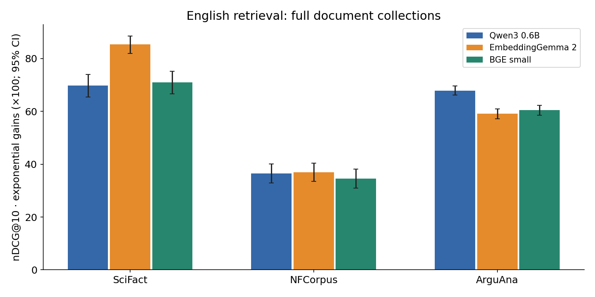
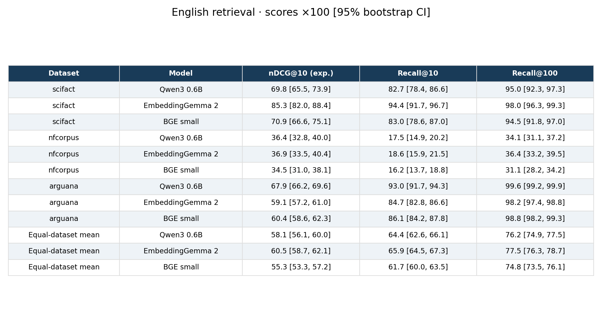
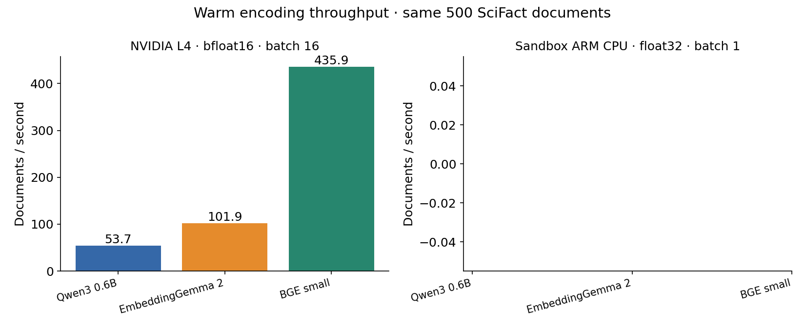
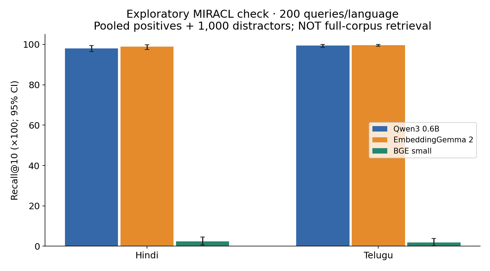

# EmbeddingGemma 2 found 2.4% more relevant documents

Experiment 098 · Hari's Tech in General · Measured 17 October 2026

**Verdict: DISPROVEN** for the joint hypothesis that Qwen wins English quality while EmbeddingGemma is faster and smaller. The predeclared English-quality test is **DISPROVEN**; the speed-and-size test is **INCONCLUSIVE**.

The headline compares the two principal models at ten retrieval slots, using the equal-dataset mean of query-level Recall@10; its paired-bootstrap 95% interval is **0.02% to 4.92%** relative improvement. It describes the share of judged relevant documents recovered, not a raw count pooled across unequal datasets.

The headline recall interval only narrowly clears zero; this is borderline evidence for the recall gain. The stronger statistical result is the predeclared ranking-quality comparison below.

## What we tested

Three public Hugging Face BEIR collections: SciFact (scientific evidence), NFCorpus (medical information), and ArguAna (argument retrieval). We used each full corpus and every official test query with a positive relevance judgment; no training or tuning. A public [EmbeddingGemma 2 checkpoint](https://huggingface.co/google/embeddinggemma-2) exists, so this experiment uses it instead of embeddinggemma-300m. Its optional image/audio towers were disabled through the [documented text-only loading configuration](https://github.com/huggingface/transformers/blob/8498ed425fa01bbee7d086efdf1a6634c2962aed/docs/source/en/model_doc/embedding_gemma2.md).

All models used native embedding dimensions, 512-token inputs, model-card retrieval prefixes, normalized embeddings, and exact cosine search. Documents with the same ID as the query were excluded; score ties use lexicographic document IDs. The fixed nDCG definition uses exponential graded gains (2^relevance−1), so NFCorpus numbers can differ from trec_eval’s linear-gain nDCG and should not be read as leaderboard scores.

## English results

Scores below are ×100, with 95% query-bootstrap confidence intervals. The mean row weights the three datasets equally.

| Dataset | Model | nDCG@10 | Recall@10 | Recall@100 |
|---|---|---:|---:|---:|
| scifact | Qwen3 0.6B | 69.8 [65.5, 73.9] | 82.7 [78.4, 86.6] | 95.0 [92.3, 97.3] |
| scifact | EmbeddingGemma 2 (text only) | 85.3 [82.0, 88.4] | 94.4 [91.7, 96.7] | 98.0 [96.3, 99.3] |
| scifact | BGE small en v1.5 | 70.9 [66.6, 75.1] | 83.0 [78.6, 87.0] | 94.5 [91.8, 97.0] |
| nfcorpus | Qwen3 0.6B | 36.4 [32.8, 40.0] | 17.5 [14.9, 20.2] | 34.1 [31.1, 37.2] |
| nfcorpus | EmbeddingGemma 2 (text only) | 36.9 [33.5, 40.4] | 18.6 [15.9, 21.5] | 36.4 [33.2, 39.5] |
| nfcorpus | BGE small en v1.5 | 34.5 [31.0, 38.1] | 16.2 [13.7, 18.8] | 31.1 [28.2, 34.2] |
| arguana | Qwen3 0.6B | 67.9 [66.2, 69.6] | 93.0 [91.7, 94.3] | 99.6 [99.2, 99.9] |
| arguana | EmbeddingGemma 2 (text only) | 59.1 [57.2, 61.0] | 84.7 [82.8, 86.6] | 98.2 [97.4, 98.8] |
| arguana | BGE small en v1.5 | 60.4 [58.6, 62.3] | 86.1 [84.2, 87.8] | 98.8 [98.2, 99.3] |
| **Equal-dataset mean** | Qwen3 0.6B | 58.1 [56.1, 60.0] | 64.4 [62.6, 66.1] | 76.2 [74.9, 77.5] |
| **Equal-dataset mean** | EmbeddingGemma 2 (text only) | 60.5 [58.7, 62.1] | 65.9 [64.5, 67.3] | 77.5 [76.3, 78.7] |
| **Equal-dataset mean** | BGE small en v1.5 | 55.3 [53.3, 57.2] | 61.7 [60.0, 63.5] | 74.8 [73.5, 76.1] |

The primary comparison is Qwen minus Google in equal-dataset macro nDCG@10. We drew 10,000 paired bootstrap samples, resampling queries within each dataset with seed 98. The interval must exclude zero in Qwen’s favor to prove its quality hypothesis; excluding zero against Qwen disproves it. These intervals reflect query sampling within these benchmarks, not uncertainty over all future domains.

| Macro paired difference: Qwen − Google | Points | 95% CI |
|---|---:|---:|
| ndcg10 | -2.41 | [-3.96, -0.90] |
| recall10 | -1.52 | [-3.11, -0.01] |
| recall100 | -1.28 | [-2.29, -0.31] |

Google’s average advantage came mainly from SciFact; Qwen won ArguAna. This domain crossover is a reason to test an embedder on your own corpus. All per-dataset paired intervals, including baseline comparisons, are saved in `results/paired_differences.csv`.

## BEIR definition sensitivity

For readers comparing with BEIR/trec_eval, the supplemental table uses linear gains in nDCG@10; the fixed primary test above retains exponential gains. The two definitions differ only on graded NFCorpus judgments in these datasets.

| Equal-dataset mean | Linear nDCG@10 ×100 [95% CI] |
|---|---:|
| Qwen3 0.6B | 58.00 [56.04, 59.96] |
| EmbeddingGemma 2 (text only) | 60.45 [58.71, 62.15] |
| BGE small en v1.5 | 55.24 [53.28, 57.20] |

The paired linear-gain macro difference (Qwen − Google) is -2.45 points [95% CI -4.02, -0.91]. This is a definition sensitivity, not an alternative decision rule.

## Size and encoding speed

One warmed timed pass over the same first 500 SciFact documents (sorted IDs), excluding download, load, and search. L4 uses bfloat16 and batch 16; the two-core ARM Neoverse-V2 sandbox uses float32 and batch 1, with two Torch threads. The clock includes tokenizer, forward pass, normalization, and returning NumPy embeddings. Different prompts yield slightly different token counts.

| Model | Loaded parameters | Native dimensions | L4 docs/s | CPU docs/s |
|---|---:|---:|---:|---:|
| Qwen3 0.6B | 595.8M | 1024 | 53.70 | unavailable |
| EmbeddingGemma 2 (text only) | 271.0M | 768 | 101.90 | unavailable |
| BGE small en v1.5 | 33.4M | 384 | 435.85 | unavailable |

EmbeddingGemma 2’s full multimodal checkpoint is approximately 744M parameters; only its approximately 271M text backbone is loaded here. Parameter counts describe the deployed text configurations, not the total bytes of every downloadable model artifact. The size claim therefore applies to text-only deployment.

Speed is a single-pass observation, with no throughput confidence interval. It is conditional on these batch sizes, document lengths, dtypes, software, and shared sandbox conditions; it is not a claim about every CPU or serving stack. All final L4 runs use upstream Transformers 5.21.0.dev0 (commit recorded in the logs), required for the newly released Google architecture. Initial Qwen/BGE results on 5.18.0 are archived separately and excluded from the final comparison; both models were rerun on the common stack. All final CPU models also use the same pinned Transformers 5.21.0.dev0 commit, with PyTorch 2.14.1+cpu; the isolated package install is recorded in the logs. Full package snapshots and checkpoint revisions are archived.

## Hindi and Telugu mini-check

This is an **exploratory pooled-candidate diagnostic**, not full MIRACL retrieval. For each language we took the first 200 lexicographic dev query IDs, included all their judged positive documents, and added the first 1,000 other corpus documents. Candidate construction uses relevance labels and is deliberately easier than searching the complete corpus; these scores must not be compared with MIRACL leaderboard values or used to claim broad multilingual superiority.

| Language | Queries | Candidate docs | Model | nDCG@10 | Recall@10 | Recall@100 |
|---|---:|---:|---|---:|---:|---:|
| hi | 200 | 1423 | Qwen3 0.6B | 93.0 [90.6, 95.3] | 98.1 [96.4, 99.4] | 100.0 [100.0, 100.0] |
| hi | 200 | 1423 | EmbeddingGemma 2 (text only) | 95.0 [92.9, 96.9] | 98.9 [97.5, 99.9] | 100.0 [100.0, 100.0] |
| hi | 200 | 1423 | BGE small en v1.5 | 1.8 [0.5, 3.4] | 2.5 [0.7, 4.6] | 12.1 [8.4, 16.2] |
| te | 200 | 1223 | Qwen3 0.6B | 97.5 [95.7, 99.0] | 99.5 [98.5, 100.0] | 100.0 [100.0, 100.0] |
| te | 200 | 1223 | EmbeddingGemma 2 (text only) | 98.9 [97.7, 99.8] | 99.7 [99.2, 100.0] | 100.0 [100.0, 100.0] |
| te | 200 | 1223 | BGE small en v1.5 | 1.2 [0.2, 2.7] | 1.8 [0.3, 3.8] | 8.9 [5.2, 12.9] |

## Plain-English takeaway

EmbeddingGemma 2 retrieved slightly more known relevant material on average across these three English tests. Qwen did better on argument retrieval, so test your own documents before choosing a model.

## Limits and reproducibility

These are three small, public benchmarks that may have appeared in model training; we cannot measure training contamination. The 512-token cap truncates long material and suppresses the models’ larger context windows. BGE is an English-focused baseline, so its Hindi/Telugu check is outside its intended specialization. Unjudged documents are treated as nonrelevant, as in benchmark evaluation. No inference-service APIs, private data, or model tuning were used.

`README.md` contains the pre-measurement plan and recorded corrections. Raw per-query metrics, top-100 English rankings, qrels/data snapshots, revisions, timing JSON, paired intervals, and an independent metric reconstruction check are in `results/`; scripts are resumable. `figures/colab_run.txt` includes GPU identification and timing evidence. GPU lifetime/CU accounting and the local commit are documented with the delivered experiment.

## Compute accounting

NVIDIA L4; session `b6-098` stopped. Resumed allocation: approximately 0.365 CU from lifetime × 1.54 CU/hour. Including the interrupted allocation, attributable usage is bounded at approximately **0.82–1.85 CU**; its exact termination time was lost, so an exact billing total is unavailable. The account balance also includes concurrent experiments and is not used as this experiment’s cost. See `results/compute_usage.json` and `figures/colab_stop.txt`.
